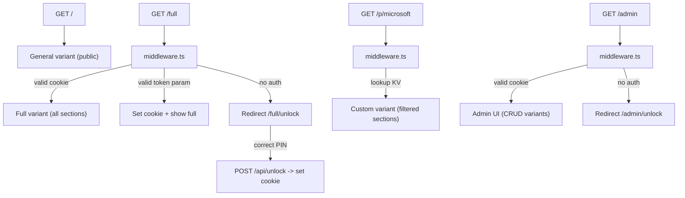

# Portfolio Variant System with Admin UI

## Architecture Overview



## URL Structure

| Path | Content | Access | SEO |
|---|---|---|---|
| `/` | General: Hero + Experience + Skills + Education + Press + Contact | Public | Indexed |
| `/full` | All sections (current homepage) | PIN `7639` or token | `noindex` |
| `/p/[slug]` | Custom section selection | Per-variant config | `noindex` |
| `/admin` | Variant management UI | PIN `7639` | `noindex` |
| `/timeline` | Unchanged | Public | Indexed |

## 1. Variant Config — [lib/variants.ts](lib/variants.ts) (new)

Defines types and built-in variants. Custom variants come from Vercel KV at runtime.

```typescript
export type SectionId =
  | "hero" | "experience" | "skills" | "education"
  | "projects" | "freelance" | "demos" | "press" | "contact";

export interface VariantConfig {
  slug: string;
  label: string;
  sections: SectionId[];
  protected: boolean;
}

export const BUILTIN_VARIANTS: Record<string, VariantConfig> = {
  general: {
    slug: "general",
    label: "General",
    sections: ["hero", "experience", "skills", "education", "press", "contact"],
    protected: false,
  },
  full: {
    slug: "full",
    label: "Full Portfolio",
    sections: ["hero", "experience", "skills", "education", "projects", "freelance", "demos", "press", "contact"],
    protected: true,
  },
};

export const ALL_SECTIONS: { id: SectionId; label: string }[] = [
  { id: "hero", label: "Hero / Profile" },
  { id: "experience", label: "Work Experience" },
  { id: "skills", label: "Skills & Technologies" },
  { id: "education", label: "Education" },
  { id: "projects", label: "Featured Projects" },
  { id: "freelance", label: "Freelance Projects" },
  { id: "demos", label: "Work Demos" },
  { id: "press", label: "In the Media" },
  { id: "contact", label: "Contact" },
];
```

`getVariant(slug)` helper: checks built-in first, then queries Vercel KV.

## 2. Auth Utilities — [lib/auth.ts](lib/auth.ts) (new)

- `verifyPin(pin)` — checks against `process.env.PORTFOLIO_PIN`
- `createToken(slug)` — HMAC-signs `{ slug }` with `process.env.PORTFOLIO_TOKEN_SECRET` (no expiry)
- `verifyToken(token)` — validates HMAC signature, returns `{ valid, slug }`
- `COOKIE_NAME = "portfolio_access"` — shared constant
- Cookie value is a signed payload so it can't be forged

## 3. Middleware — [middleware.ts](middleware.ts) (new, project root)

Intercepts `/full`, `/full/unlock`, `/p/[slug]`, and `/admin`.

Logic:
1. `/full/unlock`, `/p/*/unlock`, `/admin/unlock` — always pass through (PIN page)
2. `/full` — check `portfolio_access` cookie or `?token=` param; redirect to `/full/unlock` if neither
3. `/p/[slug]` — look up variant; if `protected`, apply same cookie/token check
4. `/admin` — check cookie; redirect to `/admin/unlock` if missing

```typescript
export const config = {
  matcher: ["/full/:path*", "/p/:variant/:path*", "/admin/:path*"],
};
```

## 4. Refactor Root `/` — edit [app/page.tsx](app/page.tsx)

Change the homepage to render only the general sections via `VariantPageContent` with `variant="general"`. Navbar filters to only show relevant links.

## 5. Full Portfolio Page — `app/full/page.tsx` (new)

Server component: `metadata` with `robots: { index: false }`, renders `VariantPageContent` with `variant="full"`.

## 6. Custom Variant Page — `app/p/[variant]/page.tsx` (new)

Server component: calls `getVariant(params.variant)` from KV, returns `notFound()` for unknown slugs, `noindex` metadata, renders `VariantPageContent`.

## 7. Shared Variant Renderer — [components/variant-page-content.tsx](components/variant-page-content.tsx) (new)

Client component that maps `SectionId` to components and renders only the configured sections:

```typescript
const SECTION_MAP: Record<SectionId, React.ComponentType> = {
  hero: HeroSection,
  experience: ExperienceSection,
  // ...all sections...
};
```

Passes `visibleSections` to Navbar.

## 8. Navbar Update — edit [components/navbar.tsx](components/navbar.tsx)

Add optional `visibleSections?: SectionId[]` prop. When provided, `navItems` is filtered to only matching sections. When omitted, shows all (backward compat for `/timeline`).

## 9. Unlock Pages (3 files, same component pattern)

- `app/full/unlock/page.tsx`
- `app/p/[variant]/unlock/page.tsx`
- `app/admin/unlock/page.tsx`

Styled PIN entry form. Submits to `POST /api/unlock` with `{ pin, redirect }`.

## 10. Unlock API — `app/api/unlock/route.ts` (new)

Validates PIN, sets `HttpOnly` `Secure` `SameSite=Lax` cookie (30-day maxAge), returns redirect URL. Returns 401 on wrong PIN.

## 11. Token API — `app/api/token/route.ts` (new)

`POST { slug }` — generates non-expiring signed token, returns full share URL. Protected by PIN cookie.

## 12. Variants API — `app/api/variants/route.ts` (new)

- `GET` — list all custom variants from KV
- `POST { slug, label, sections, protected }` — create/update in KV
- `DELETE { slug }` — remove from KV

All protected by PIN cookie.

## 13. Admin UI — `app/admin/page.tsx` (new)

PIN-protected page with:
- Table of all custom variants with edit/delete
- "Create variant" form: name, slug, section checkboxes, protected toggle
- Copy share URL button per variant
- "Generate token link" button for protected variants

## 14. Vercel KV Setup

- Install `@vercel/kv`
- Key pattern: `variant:{slug}` -> JSON VariantConfig
- `variant:_index` -> JSON array of custom slugs

## 15. Environment Variables — `.env.local`

```
PORTFOLIO_PIN=7639
PORTFOLIO_TOKEN_SECRET=<random-32-char-string>
KV_REST_API_URL=<from-vercel-dashboard>
KV_REST_API_TOKEN=<from-vercel-dashboard>
```

## Files Summary

| File | Action |
|---|---|
| `lib/variants.ts` | New |
| `lib/auth.ts` | New |
| `middleware.ts` | New |
| `app/page.tsx` | Edit — use VariantPageContent with general config |
| `app/full/page.tsx` | New |
| `app/full/unlock/page.tsx` | New |
| `app/p/[variant]/page.tsx` | New |
| `app/p/[variant]/unlock/page.tsx` | New |
| `components/variant-page-content.tsx` | New |
| `components/navbar.tsx` | Edit |
| `app/api/unlock/route.ts` | New |
| `app/api/token/route.ts` | New |
| `app/api/variants/route.ts` | New |
| `app/admin/page.tsx` | New |
| `app/admin/unlock/page.tsx` | New |
| `.env.local` | New |
